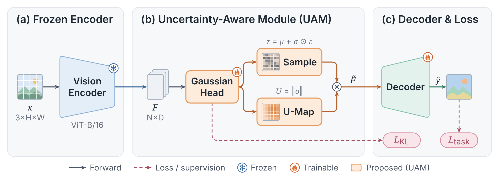
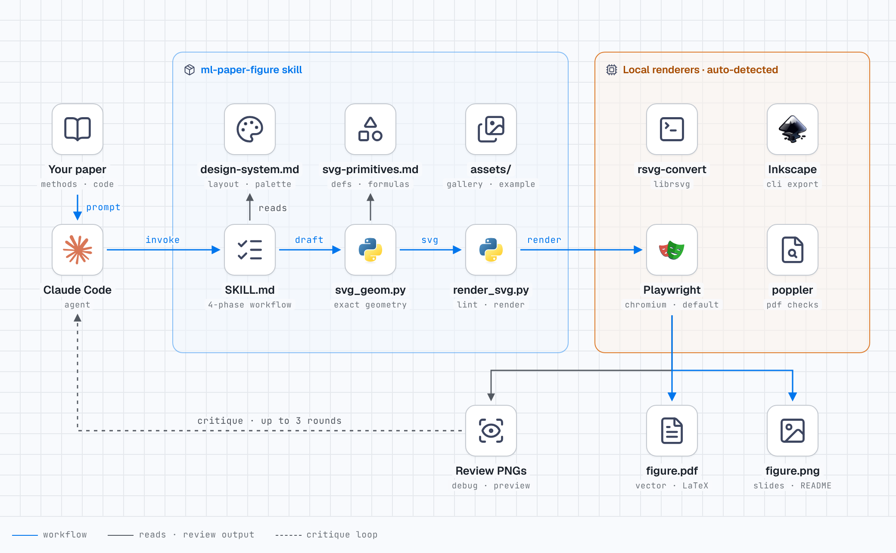

# ml-paper-figure

An agent skill that draws **Figure 1** for ML papers (framework overviews, model architectures, method pipelines) as a
self-contained SVG, a vector PDF for LaTeX, and a high-res PNG. Instead of writing SVG in one shot, the agent plans a
blueprint, drafts, then renders and critiques its own output (up to three rounds) with an offline lint script before
exporting.



<sub>Verification run: frozen encoder → proposed module → decoder with dashed loss paths, NeurIPS width, 0 lint issues.
See the <a href="examples/uncertainty-aware/critique-log.md">critique log</a>.</sub>

## Install

```bash
npx github:JihuLee/ml-paper-figure
```

This copies the skill to `~/.claude/skills/ml-paper-figure` for Claude Code. Options:

| Flag | Installs to |
|---|---|
| *(none)* or `--global` | `~/.claude/skills/ml-paper-figure` (every project) |
| `--project` | `./.claude/skills/ml-paper-figure` (current project) |
| `--agents` | `./.agents/skills/ml-paper-figure` (agents that read `.agents/skills`) |
| `--dir <path>` | `<path>/ml-paper-figure` |

Add `--force` to update an existing install, `--uninstall` to remove it, or `--dry-run` to preview.
You can also use the [skills CLI](https://github.com/vercel-labs/skills), which supports many agents:

```bash
npx skills add JihuLee/ml-paper-figure
```

Then check which renderers the skill can use:

```bash
python3 ~/.claude/skills/ml-paper-figure/scripts/render_svg.py --list-backends
```

## Usage

Ask your agent for a figure in plain language. Paste or point to Methods text, LaTeX, Markdown or PyTorch code:

> Make Figure 1 for our NeurIPS paper from Section 3. The ViT encoder is frozen; our contribution is the gating module.

The agent writes `figure1.blueprint.md`, `figure1.svg`, then `figure1.pdf` and `figure1.png`, and reports the
smallest printed font size and any accepted warnings.

## How it works

<picture>
  <source media="(prefers-color-scheme: dark)" srcset="docs/architecture-dark.png">
  
</picture>

1. **Plan.** Extract stages, modules, tensor shapes and flows. Fix the canvas (2 SVG units = 1 printed pt for the
   target venue) and every module's box before drawing.
2. **Draft.** Write one self-contained SVG from tested primitives: role-colored arrowheads, vector frozen/trainable
   badges, trapezoids, stacks and mini visualizations. `svg_geom.py` computes the exact paths.
3. **Render & critique.** `render_svg.py` lints the geometry (overflowing text, arrows through boxes, floating
   arrowheads, near-misalignment, font size in printed pt) and writes a debug overlay and a printed-size preview for
   the agent to inspect. At most three rounds.
4. **Export.** Vector PDF sized to the venue's printed width, high-res PNG, and PDF checks (single page, no
   rasterization, no Type 3 fonts).

## Layout

```
.claude/skills/ml-paper-figure/
├── SKILL.md                     # trigger + 4-phase protocol + quality bar
├── references/
│   ├── design-system.md         # venue sizes, spacing, palette roles, type tiers, metaphors, connectors
│   └── svg-primitives.md        # copy-paste <defs>, text and path formulas, ML shape templates
├── scripts/
│   ├── render_svg.py            # lint, render (PNG/PDF), review images, PDF checks
│   └── svg_geom.py              # exact coordinates for paths, shapes, grids, labels
└── assets/                      # primitives gallery, complete example figure
bin/install.js                   # npx installer
examples/uncertainty-aware/      # verification run: input → blueprint → 3 rounds → outputs
docs/                            # diagram above (HTML source + PNGs)
```

## Requirements

- Python 3.8+ and one SVG renderer. The script auto-detects them in this order: Chromium via
  [Playwright](https://playwright.dev/python/) (recommended; needed for exact geometry lint), `rsvg-convert`, Inkscape,
  cairosvg, resvg (PNG only).
- Optional: poppler-utils (PDF checks and Type 3 → outline conversion) and Pillow (PNG/PDF comparison).
- Node.js 14.14+ for the npx installer only.

Everything runs locally; no cloud APIs.

## Standalone scripts

Run from the skill folder (`~/.claude/skills/ml-paper-figure` after install):

```bash
python3 scripts/render_svg.py fig.svg --target neurips            # review: PNG + debug + preview + lint report
python3 scripts/render_svg.py fig.svg --target cvpr --export      # final: vector PDF + high-res PNG + PDF checks
python3 scripts/svg_geom.py elbow 382,140 412,100 --mode hvh --mid 390 --arrow --marker ah-proposed
```

`--target` accepts `neurips`, `iclr`, `icml`, `icml-col`, `cvpr`, `cvpr-col`, `eccv`, `acl`, `acl-col`, `aaai`,
`aaai-col`, or a length such as `5.5in`.

## Status

Tested: the Chromium (Node Playwright) path for exact lint, rendering, debug overlays and vector PDF; approximate lint
without a browser (`--no-browser`); Type 3 outlining; the npx installer. Implemented but not yet tested: the
rsvg-convert, Inkscape, cairosvg and resvg backends and the Python Playwright driver. The `npx skills add` route
follows the skills CLI's documented discovery of `.claude/skills/` but has not been run against this repo.

<sub>Architecture diagram made with stack-diagram (source: <a href="docs/architecture.html">docs/architecture.html</a>).
Icons: devicon and Lucide.</sub>
