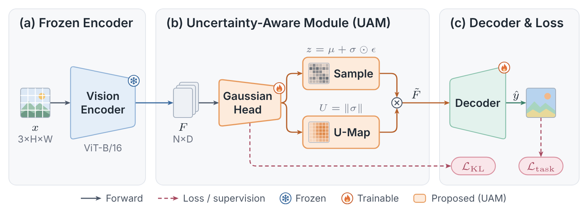

# ml-paper-figure

An agent skill that draws **Figure 1** for ML papers (framework overviews, model architectures, method pipelines) as a
self-contained SVG, a vector PDF for LaTeX, and a high-res PNG. Instead of writing SVG in one shot, the agent plans a
blueprint, drafts, then renders and critiques its own output (up to three rounds) with an offline lint script before
exporting.



<sub>Example: frozen encoder → proposed module → decoder with dashed loss paths, at NeurIPS width. The first verification
run is recorded in the <a href="examples/uncertainty-aware/critique-log.md">critique log</a>.</sub>

## Install

```bash
npx skills add JihuLee/ml-paper-figure -g
```

The [skills CLI](https://github.com/vercel-labs/skills) (Node.js 22.20+) detects your coding agents and links the
skill into each one, e.g. `~/.claude/skills/ml-paper-figure` for Claude Code. Add `-a claude-code` to target one
agent, or drop `-g` to install into the current project only.

| Task | Command |
|---|---|
| Update | `npx skills update -g` |
| List | `npx skills ls -g` |
| Remove | `npx skills remove --global ml-paper-figure` |

Without Node.js, copy `skills/ml-paper-figure/` into your agent's skills folder.

Then check which renderers the skill can use:

```bash
python3 ~/.claude/skills/ml-paper-figure/scripts/render_svg.py --list-backends
```

## Usage

Ask your agent for a figure in plain language. Paste or point to Methods text, LaTeX, Markdown or PyTorch code:

> Make Figure 1 for our NeurIPS paper from Section 3. The ViT encoder is frozen; our contribution is the gating module.

The agent writes `figure1.blueprint.md`, `figure1.svg`, then `figure1.pdf` and `figure1.png`, and reports the
smallest printed font size and any accepted warnings.

## How it works

<picture>
  <source media="(prefers-color-scheme: dark)" srcset="docs/architecture-dark.png">
  
</picture>

1. **Plan.** Extract stages, modules, tensor shapes and flows. Fix the canvas (2 SVG units = 1 printed pt for the
   target venue) and every module's box before drawing.
2. **Draft.** Write one self-contained SVG from tested primitives: role-colored arrowheads, vector frozen/trainable
   badges, trapezoids, stacks and mini visualizations. `svg_geom.py` computes the exact paths. Math is written as
   LaTeX between `$…$` (`scores $S[i,v,p]$`) and typeset by LaTeX in the paper's math font and macros.
3. **Render & critique.** `render_svg.py` lints the geometry (overflowing text, arrows through boxes, floating
   arrowheads, near-misalignment, font size in printed pt, math script sizes) and writes a debug overlay and a
   printed-size preview for the agent to inspect. At most three rounds.
4. **Export.** Vector PDF sized to the venue's printed width, high-res PNG, and PDF checks (single page, no
   rasterization, Type 1/TrueType fonts only). Math keeps its real Type 1 fonts (e.g. CMMI6 with CMMI5 scripts).

## Layout

```
skills/ml-paper-figure/
├── SKILL.md                     # trigger + 4-phase protocol + quality bar
├── references/
│   ├── design-system.md         # venue sizes, spacing, palette roles, type tiers, metaphors, connectors
│   └── svg-primitives.md        # copy-paste <defs>, text and path formulas, ML shape templates
├── scripts/
│   ├── render_svg.py            # lint, render (PNG/PDF), review images, PDF checks
│   ├── tex_math.py              # $…$ math: paper preamble/macros, latex -> dvisvgm, pdflatex snippets for the PDF
│   └── svg_geom.py              # exact coordinates for paths, shapes, grids, labels
└── assets/                      # primitives gallery, complete example figure
examples/uncertainty-aware/      # verification run: input → blueprint → 3 rounds → outputs
docs/                            # diagram above (HTML source + PNGs)
```

## Requirements

- Python 3.8+ and one SVG renderer. The script auto-detects them in this order: Chromium via
  [Playwright](https://playwright.dev/python/) (recommended; needed for exact geometry lint), `rsvg-convert`, Inkscape,
  cairosvg, resvg (PNG only).
- For `$…$` math: a TeX distribution with `latex`, `pdflatex`, `dvisvgm` and `kpsewhich` (TeX Live, MiKTeX or
  TinyTeX; `dvisvgm` is a separate package in TinyTeX), and PyMuPDF (`pip install pymupdf`) to embed the real math
  fonts in the PDF. Without PyMuPDF the math in the PDF stays as glyph outlines; without TeX the lint reports the math
  as untypeset. Nothing is installed automatically.
- Optional: poppler-utils (PDF checks and Type 3 → outline conversion) and Pillow (PNG/PDF comparison).
- Node.js 22.20+ for `npx skills` only.

Everything runs locally; no cloud APIs.

## Standalone scripts

Run from the skill folder (`~/.claude/skills/ml-paper-figure` after install):

```bash
python3 scripts/render_svg.py fig.svg --target neurips            # review: PNG + debug + preview + lint report
python3 scripts/render_svg.py fig.svg --target cvpr --export      # final: vector PDF + high-res PNG + PDF checks
python3 scripts/render_svg.py fig.svg --target cvpr-col --paper ../paper/main.tex   # $…$ math in the paper's setup
python3 scripts/render_svg.py fig.svg --export --font-dir ~/fonts/ttf               # keep real fonts: TrueType copies of .otf fonts
python3 scripts/tex_math.py --paper ../paper/main.tex --show       # the math preamble and macros taken from the paper
python3 scripts/svg_geom.py elbow 382,140 412,100 --mode hvh --mid 390 --arrow --marker ah-proposed
```

`--target` accepts `neurips`, `iclr`, `icml`, `icml-col`, `cvpr`, `cvpr-col`, `eccv`, `acl`, `acl-col`, `aaai`,
`aaai-col`, or a length such as `5.5in`.

## Status

Tested: the Chromium path (Node and Python Playwright) for exact lint, rendering, debug overlays and vector PDF;
approximate lint without a browser (`--no-browser`); Type 3 outlining with pdftocairo; `--font-dir` (TrueType fonts
replace CFF fonts of the same family); the `glyph-fallback`, `verbose-label` and `plain-component` lints; `$…$` math
with TinyTeX (latex, pdflatex, dvisvgm 3.6) and PyMuPDF; install and update with `npx skills`. Implemented but not yet
tested: the rsvg-convert, Inkscape, cairosvg and resvg backends, the PyMuPDF fallback that builds the SVG glyphs
without dvisvgm, and the PyMuPDF outliner used when pdftocairo is missing.

<sub>Architecture diagram made with stack-diagram (source: <a href="docs/architecture.html">docs/architecture.html</a>).
Icons: devicon and Lucide.</sub>
